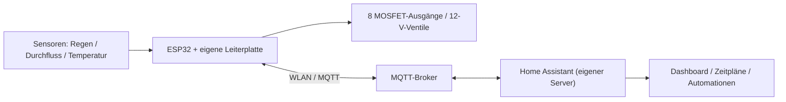

# ESP32-basierte intelligente Bewässerungssteuerung

Eigenständig entwickeltes Automatisierungsprojekt | Embedded Systems · PCB-Design · IoT · Home Assistant

Gegenstand des Projekts ist die Entwicklung einer modularen Bewässerungssteuerung für bis zu acht elektrisch geschaltete Ventile. Neben der Sensorüberwachung und der zentralen Bedienung über Home Assistant umfasst die Entwicklung die elektrische Planung, den Leiterplattenentwurf, die Firmware-Konfiguration sowie die Integration in eine lokale Server- und Netzwerkinfrastruktur.

> Projektstatus: Die Leiterplatte wurde gefertigt; der ESP32 und bislang eine der acht Ventilstufen sind bestückt. Die ESPHome-Konfiguration und die Home-Assistant-Zeitpläne sind eingerichtet. Die vollständige Bestückung und der hydraulische Test im Garten stehen noch aus, da Leitungen und Wasserverteiler noch nicht fertiggestellt sind.

## 1. Systemübersicht

Entwicklungsziele
- Lokale Steuerung ohne zwingende Cloud-Anbindung
- Individuell schaltbare Bewässerungszonen
- Messwerterfassung zur Überwachung und späteren Regelung
- Zeitsteuerung und zentrale Visualisierung
- Erweiterbarkeit und Schutz gegen Fehlbedienung

## 2. Hardwareentwicklung

Schaltplan und Leiterplattenlayout wurden mit KiCad erstellt. Als Controller dient ein DFRobot FireBeetle 2 ESP32-E. Für die acht Ventile sind jeweils diskrete Low-Side-MOSFET-Stufen vorgesehen.

| Baugruppe | Technische Umsetzung |
|---|---|
| Controller | ESP32-E, WLAN, ESPHome |
| Ventilausgänge | 8 × GPIO 18, 13, 14, 26, 25, 4, 17, 16 |
| Leistungsschalter | IRLZ44N, 300 Ω Gate-Widerstände (gemäß KiCad-Stückliste) |
| Schutz der Ausgänge | Freilaufdiode 1N4007 je Magnetventil |
| Versorgung | 12 V DC für Ventile, DC/DC-Wandler für 5 V |
| Regen | RS12, GPIO36, digitales Signal mit Pegelanpassung |
| Temperatur | NTC, GPIO34 (ADC); Widerstandswerte gemäß Firmware |
| Durchfluss | YF-B7, Impulssignal an GPIO35 |

Zum Einsatz kommen stromlos geschlossene Magnetventile (NC). Bei der Schaltungsauslegung wurden die induktive Last, die GPIO-Pegel, die Strompfade der Ventile sowie die erforderliche Pegelanpassung der Sensorsignale berücksichtigt.

Leiterplattenentwurf: Das Layout berücksichtigt Leistungs- und Logiksignale. Schraubklemmen für externe Komponenten, Stützkondensatoren und Befestigungsbohrungen sind vorgesehen.

Weitere technische Einzelheiten: [Hardwaredokumentation](hardware/README.md).

## 3. Firmware und Kommunikation

Die Firmware basiert auf ESPHome mit ESP-IDF. GPIO-Ausgänge, Sensoren und Netzwerkkommunikation werden deklarativ konfiguriert. Die Verbindung zum Home-Assistant-Server erfolgt derzeit über WLAN und MQTT.

- Schaltbefehle für die acht Ventile
- Übertragung von Sensor- und Betriebszuständen
- Lokale WLAN-Kommunikation und OTA-Updates
- MQTT-Anbindung an den eigenen Broker

Die aktuelle ESPHome-Konfiguration liegt unter [firmware/bewaesserung.yaml](firmware/bewaesserung.yaml).

## 4. Home Assistant und Automatisierung

Home Assistant OS wird in einer virtuellen Maschine auf einem lokalen Server betrieben. Ein MQTT-Broker vermittelt die Kommunikation mit dem ESP32. Über das Dashboard lassen sich Ventile, Sensordaten und Zeitpläne verwalten.

Bereits eingerichtet: Die manuelle Steuerung und die Zeitpläne funktionieren softwareseitig. Da bisher nur eine Ventilstufe bestückt ist, steht die vollständige Prüfung aller acht Ausgänge und des Wasserflusses unter realen Bedingungen noch aus.

In Home Assistant konfiguriert, aber noch nicht vollständig unter realen Bedingungen geprüft:
- Regensperre mit Sensor- und Wetterinformationen (YAML vorhanden, Funktionstest offen)
- Begrenzung gleichzeitig aktiver Ventile (Standardwert: drei; nur über die vorgesehenen Startpfade)
- Maximale Ventillaufzeit und Konfliktwarnungen (YAML vorhanden, Funktionstest offen)
- Durchflussüberwachung zur Erkennung auffälliger Betriebszustände (YAML vorhanden, Kalibrierung offen)

Details: [Home-Assistant-Dokumentation](home-assistant/README.md).

## 5. Aktueller Entwicklungsstand und Tests

Der ESP32, die Spannungsversorgung und die Sensoranschlüsse sind aufgebaut; von acht vorgesehenen Ventilstufen ist bislang eine bestückt. Die Zeitplanlogik wurde bereits erprobt. Ein vollständiger hydraulischer Test ist erst nach der Installation der Gartenleitungen und Wasserverteiler möglich. Die Durchflusskalibrierung und die Erprobung der Schutzfunktionen stehen ebenfalls noch aus.

Beim RS12-Regensensor zeigte sich ein von der dokumentierten Open-Collector-Schaltung abweichendes Ausgangsverhalten. Zur Anpassung wurde auf der Leiterplattenrückseite ein zusätzlicher Widerstand zwischen Sensorsignal und GND angebracht. Die Pegelanpassung an den ESP32 erfolgt über einen Spannungsteiler. Die elektrische Funktion der Nacharbeit wurde erfolgreich geprüft; die Änderung ist noch nicht in den KiCad-Schaltplan und das Leiterplattenlayout übernommen worden.

Das Projekt vereint Schaltungsentwicklung, PCB-Layout, Mikrocontroller-Konfiguration, Netzwerkkommunikation und Automatisierungstechnik in einem zusammenhängenden System.

## 6. Geplante Erweiterungen

Die folgenden Erweiterungen sind für weitere Entwicklungsschritte vorgesehen. Sie sind noch nicht vollständig umgesetzt oder erprobt:

- ESP-NOW-zu-Ethernet-Gateway: Ein zusätzlicher Waveshare-ESP mit Ethernet-Anschluss ist als Gateway vorgesehen. Die Kommunikation mit dem Bewässerungscontroller soll über ESP-NOW erfolgen; die Anbindung an das Heimnetz über LAN. Anlass ist die eingeschränkte 2,4-GHz-WLAN-Versorgung durch die vorhandene FRITZ!Box. Die Gateway-Firmware und die Weiterleitung der MQTT-Daten müssen noch entwickelt und erprobt werden.
- Unabhängige Laufzeitbegrenzung auf dem ESP32: Ergänzend zu den Home-Assistant-Automationen ist eine lokale Abschaltung vorgesehen, falls die Serververbindung ausfällt oder ein Ventil zu lange eingeschaltet bleibt.
- Absicherung aller Schaltwege: Die Begrenzung gleichzeitig geöffneter Ventile soll später auch dann zuverlässig gelten, wenn ein Ausgang direkt und nicht über die vorgesehenen Home-Assistant-Skripte geschaltet wird.
- Robustere Fehlererkennung: Der Durchflusssensor soll kalibriert werden. Zudem ist eine differenzierte Erkennung und Meldung von Sensorfehlern, fehlendem Durchfluss und auffälligem Wasserverbrauch geplant.
- Vollständige Inbetriebnahme: Nach Fertigstellung der Gartenleitungen sind die Bestückung aller acht Ventilstufen, die Prüfung der Sensorik unter realen Bedingungen und die systematische Erprobung der Schutzfunktionen vorgesehen.

---

Dokumentationshinweis: Die Bilder zeigen den derzeitigen Entwicklungsstand; insbesondere ist die Leiterplatte noch nicht vollständig bestückt. Die bereinigte ESPHome-Konfiguration und die vollständige Bewässerungs-YAML von Home Assistant sind enthalten. Die vollständigen KiCad-Quelldateien mit Schaltplan, PCB-Layout und Bibliotheken liegen unter [hardware/kicad/](hardware/kicad/); lediglich die optionale große STEP-Datei ist nicht enthalten.
